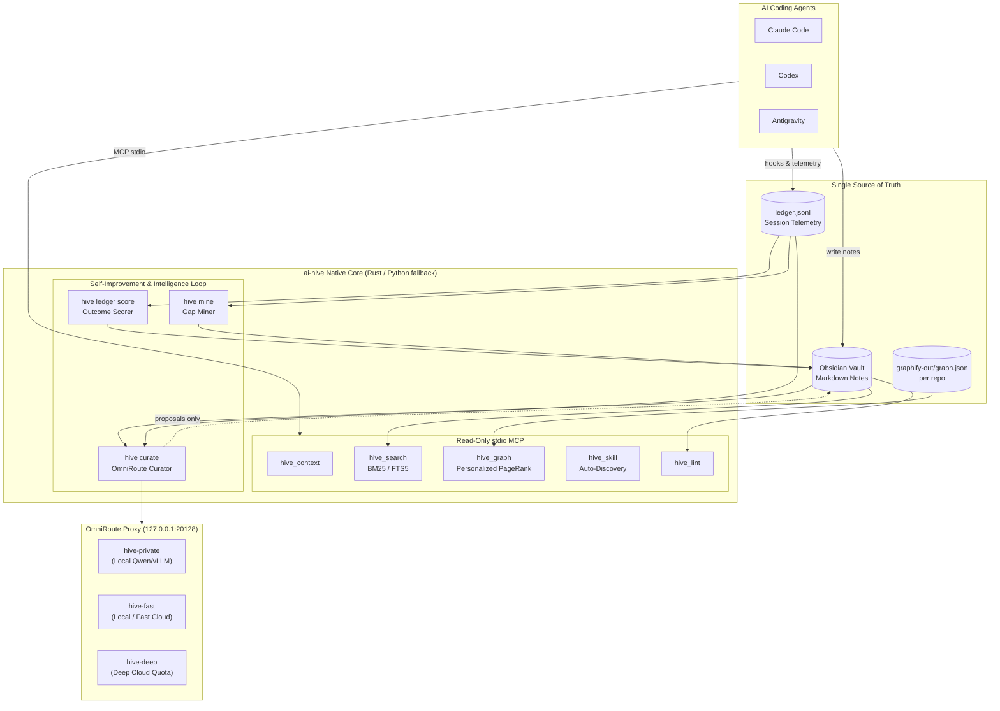

# ai-hive

**One shared, self-improving memory for every coding agent on your machine.**

ai-hive turns an Obsidian vault and [graphify](https://docs.graphify.com) code graphs into a single, high-performance memory layer that Claude Code, OpenAI Codex, and Google Antigravity all read from over MCP. Agents write plain Markdown notes; the hive indexes them, ranks them, packs them into a token budget, checks the vault's health, auto-discovers skills, learns reusable lessons from each session, and curates intelligence through tiered local models.

- **Fast:** Native Rust static binary (`hive.exe`, 1.8 MB) with bundled SQLite FTS5. Instant cold startup (<1 ms), vault search in ~4 ms, and graph Personalized PageRank in 7.8–32.6 ms (2-3x speedup over Python). Pure Python stdlib fallback with zero external dependencies.
- **Safe & Private:** The MCP server is read-only and runs over stdio with zero open network ports. Notes remain the single source of truth; indexes are disposable. Private repos are hard-locked to local-only inference (`hive-private`), and pre-egress secret scrubbing (`F10`) redacts tokens and keys before serialization.
- **Self-improving:** Objective session outcome scoring (`hive ledger score`), recurring gap mining into `inbox/` (`hive mine`), deterministic ACE playbook merges, and automatic time decay for stale bullets (`seen >= 10`, 0 helpful, >30 days).
- **Auto-Skill Discovery:** Dynamic multi-root skill scanner, prefix-stemming intent matcher, remote registry discovery, CVE-2021-42574 Trojan Source / Unicode security audit gate, and SHA-256 tree hashing lockfile.
- **Tiered Intelligence Engine:** Local OmniRoute gateway (`src/llm.rs`) supporting tiered model combos (`hive-private`, `hive-fast`, `hive-deep`) and human-in-the-loop curation (`hive curate`) that proposes changes exclusively to `vault/inbox/`.
- **Self-checking:** Cross-platform pre-commit quality gate (`hive pre-commit`) running deterministic lint rules, link checks, frontmatter validation, and test suites in under 8 seconds.



## Quick Start

### Option A: Standalone Rust Binary (Recommended, <1 ms startup)
```bash
git clone https://github.com/4LPH7/ai-hive.git
cd ai-hive
cargo build --release                    # produces target/release/hive (.exe)
cargo test                              # 33 unit + integration tests (all green)
./target/release/hive status            # index vault, list freshness and graph nodes
```

### Option B: Pure Python (Stdlib only, zero install)
```bash
python -m unittest                      # 99 tests passing (no network, no model)
python hive.py status                   # automatically delegates to native binary if compiled!
set HIVE_FORCE_PYTHON=1                 # force pure Python fallback anytime
```

## Configuration Hierarchy (`CONF-01`)

Hive resolves configuration paths using a strict 4-level priority chain:

1. **CLI Flags**: `--vault <path>`, `--projects <path>`, `--db <path>`, `--config <file>`
2. **Environment Variables**: `HIVE_VAULT`, `HIVE_PROJECTS`, `HIVE_DB`
3. **User Config (`config.toml` or `hive.toml`)**:
   - Windows: `%APPDATA%\hive\config.toml` or `~/.config/hive/config.toml`
   - Linux/macOS: `~/.config/hive/config.toml`
   ```toml
   vault = "/path/to/Obsidian/Vault"
   projects = "/path/to/Projects"
   db = "/path/to/cache/hive.sqlite"

   [llm]
   enabled = true
   base_url = "http://127.0.0.1:20128/v1"
   timeout_ms = 30000
   default_privacy = "private"

   [llm.combos]
   private = "hive-private"
   fast = "hive-fast"
   deep = "hive-deep"

   [projects.offmesh]
   llm_privacy = "private" # hard-lock: never leaves localhost
   ```
4. **Platform Defaults**:
   - Windows: `D:\Valut\OBS` if present, else `~/Documents/Vault`; `%LOCALAPPDATA%\hive\hive.sqlite`
   - Linux/macOS: `~/Documents/Vault`; `~/.cache/hive/hive.sqlite`

## Agent MCP Registration

### Antigravity (`~/.gemini/antigravity/mcp.json`)
```json
{
  "mcpServers": {
    "hive": {
      "command": "d:/PROJECTS/Ai-hive/target/release/hive.exe",
      "args": ["serve"]
    }
  }
}
```

### Claude Code (`~/.claude/settings.json` or CLI)
```bash
claude mcp add hive -- d:/PROJECTS/Ai-hive/target/release/hive.exe serve
```

### Codex (`~/.codex/config.toml`)
```toml
[mcp.servers.hive]
command = "d:/PROJECTS/Ai-hive/target/release/hive.exe"
args = ["serve"]
```

## MCP Tools

| Tool | What it returns |
|------|-----------------|
| `hive_context(project, task?, budget=1500)` | Session-start pack: active-work row, `_memory.md`, ADR list, top playbook lessons, and matching notes & ranked code symbols packed to the token budget |
| `hive_search(query, project?, limit=8)` | BM25 search over every note; title weighted x5; ADRs and project memory boosted; superseded/archived demoted; weak tail cut |
| `hive_graph(repo, query, limit=15)` | graphify code graph: identifier seeds, Personalized PageRank over 2-hop neighbourhood with hub dampening; symbols with `file:line`, edges, related notes, staleness warning |
| `hive_skill(query, limit=3)` | Auto-discovered skill matcher: matches task intent against multi-root skills using prefix-stemming; returns actionable instructions |
| `hive_status()` | Notes per project, graph size and freshness per repo |
| `hive_lint()` | Vault health against the vault manual's deterministic rules |

## Command Line Interface

| Command | Purpose |
|---------|---------|
| `hive serve` | MCP stdio server (what agents launch) |
| `hive search\|graph\|context\|status\|lint` | Core memory tools for humans and hook scripts |
| `hive skill [match\|find\|install]` | Match skills by intent, search remote registries, or install with audit gate |
| `hive ledger [show\|score]` | Inspect session telemetry or run objective outcome scoring against git diffs and test codes |
| `hive mine [--dry-run]` | Scan zero-hit queries and unfulfilled skills, clustering into proposal notes in `inbox/` |
| `hive curate [--project <p>] [--dry-run]` | Propose playbook merges & contradiction checks via OmniRoute into `inbox/` |
| `hive pre-commit` | Cross-platform pre-commit quality gate (vault lint + test suite under 8s) |
| `hive eval` | Recall@5 and MRR over golden question set |
| `hive bench` | Latency benchmarks for index, search, and graph PPR |
| `hive ace apply <scope> <delta.json>` | Merge reflections into playbooks under atomic `PlaybookLock` |

## Repository Layout

```
ai-hive/
├── src/                  Rust native core (v2.5.0)
│   ├── main.rs           CLI router, subcommands, and pre-commit runner
│   ├── lib.rs            Module exports and library interface
│   ├── index.rs          SQLite FTS5 index, hash-verified refresh (SYNC-01)
│   ├── graph.rs          graphify loader, seed scoring, and directed PPR
│   ├── skill.rs          Auto-skill engine, audit gate, and lockfile
│   ├── ledger.rs         Session telemetry logger and outcome scorer
│   ├── miner.rs          Zero-hit gap miner and proposal generator
│   ├── llm.rs            OmniRoute HTTP client, secret scrubber, privacy lock
│   ├── curate.rs         Curation engine and structured validation gate
│   ├── ace.rs            Atomic playbook locking, time decay, bullet parser
│   ├── lint.rs           Vault rule checks and ADR symbol-staleness linter
│   └── common.rs         Config parser, token estimator, path sanitizer
├── hive.py               Python MCP stdio server & delegation shims (SHIM-01)
├── ace.py                Python ACE curator & session hooks
├── lint.py               Python vault linter & ADR symbol validator
├── skill.py              Python auto-skill discovery & audit gate
├── ledger.py             Python ledger logger & outcome scorer
├── miner.py              Python gap miner & clustering
├── llm.py                Python OmniRoute gateway client
├── curate.py             Python curate engine
├── test_*.py             Python unittest suites (99 tests, 0 network, stdlib only)
├── tests/                Rust integration tests (15 tests)
├── skills/               Bundled skills and agent extensions
└── docs/                 Architecture, setup, decisions, ACE, lint
```

## Documentation

1. [Architecture](docs/architecture.md): components, data flow, ranking maths, performance
2. [Setup, step by step](docs/setup.md): from an empty folder to three agents sharing one memory
3. [Vault conventions](docs/vault-conventions.md): folder and frontmatter contract agents follow
4. [ACE playbooks](docs/ace.md): how the hive learns lessons from sessions
5. [Lint](docs/lint.md): every check, its severity and how to fix it
6. [Design decisions](docs/decisions.md): what was built, what was rejected, and why
7. [Improvements roadmap](docs/improvements.md): what is worth building next, and the signal for each

## Performance & Quality Benchmarks

Measured on Windows 11 with 76 notes and 4 graphify graphs (1k–3.5k nodes):

| Operation | Time / Metric |
|-----------|---------------|
| Cold Binary Startup | < 1 ms |
| Vault Refresh (hash-verified) | ~10 ms (skips untouched notes) |
| BM25 / FTS5 Search | ~4 ms |
| Graph PPR (1,698 nodes) | 7.8 ms |
| Graph PPR (3,427 nodes) | 32.6 ms |
| Search Golden Eval | Recall@5 1.00 (30/30), MRR 0.850 |
| Skill Routing Eval | 100% (20/20 calibrated intents) |
| Pre-Commit Quality Gate | 6.2 s (lint + 33 Rust tests + 99 Python tests) |

## License

[MIT](LICENSE)
