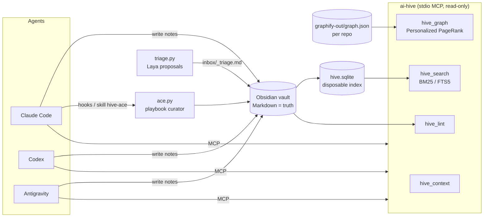

# ai-hive

**One shared, self-improving memory for every coding agent on your machine.**

ai-hive turns an Obsidian vault and [graphify](https://docs.graphify.com) code graphs into a single memory layer
that Claude Code, OpenAI Codex and Google Antigravity all read from over MCP. Agents write plain Markdown
notes; the hive indexes them, ranks them, packs them into a token budget, checks the vault's health, learns
reusable lessons from each session, and triages new captures with a small calibrated decision model.

- **Fast:** stdlib-only Python, SQLite FTS5 index outside the vault. Vault search in about 3 ms, code-graph
  queries in 10-60 ms on 1k-3.5k node graphs.
- **Safe:** the MCP server is read-only and has no network port. Notes stay the source of truth; every index
  is disposable and rebuilds from disk.
- **Self-improving:** ACE playbooks with helpful/harmful counters, merged deterministically, so lessons
  accumulate without being rewritten into vague summaries.
- **Self-checking:** a lint pass enforces the vault's own rules (line caps, frontmatter, broken links,
  superseded decisions, sources on agent-written notes).
- **Self-organising:** an optional [Laya](https://huggingface.co/convaiinnovations/laya) triage step proposes a
  project and kind for every inbox capture and learns from the answers you confirm.



## Quick start

```bash
git clone https://github.com/4LPH7/ai-hive.git
cd ai-hive
python -m unittest                       # 41 tests, stdlib only
set HIVE_VAULT=D:\path\to\vault          # or export on macOS/Linux
python hive.py status                    # index the vault, list graphs
python hive.py search "why sqlite"       # BM25 over notes
python hive.py lint                      # vault health report
```

Then register `python -I /path/to/ai-hive/hive.py serve` as an MCP server in each agent.
[docs/setup.md](docs/setup.md) walks through the full installation, step by step.

## MCP tools

| Tool | What it returns |
|------|-----------------|
| `hive_context(project, task?, budget=1500)` | Session-start pack: the project's active-work row, `_memory.md`, ADR list, top playbook lessons, and (with a task) matching notes and ranked code symbols, greedily packed to the token budget |
| `hive_search(query, project?, limit=8)` | BM25 over every note; title weighted x5; ADRs and project memory boosted; superseded or archived notes demoted; weak tail cut |
| `hive_graph(repo, query, limit=15)` | graphify code graph: identifier seeds, Personalized PageRank over the 2-hop neighbourhood with hub dampening; symbols with `file:line`, edges, related notes, staleness warning |
| `hive_status()` | Notes per project, graph size and freshness per repo |
| `hive_lint()` | Vault health against the vault manual's rules |

## Command line

| Command | Purpose |
|---------|---------|
| `python hive.py serve` | MCP stdio server (what agents launch) |
| `python hive.py search\|graph\|context\|status\|lint ...` | Same tools for humans and hook scripts |
| `python hive.py eval` | Recall@5 and MRR of search over your golden question set |
| `python hive.py bench` | Index, search and graph timings |
| `python ace.py apply <scope> <delta.json>` | Merge a reflection into a playbook |
| `python ace.py show <scope> ["task"]` | Bullets an agent would be shown |
| `python ace.py hook-start\|hook-stop` | Claude Code hook entry points |
| `python lint.py [vault]` | Lint report; exit code 1 on any error |
| `<laya-venv>/python triage.py scan\|confirm\|eval` | Laya inbox triage (optional) |

## Repository layout

```
ai-hive/
├── hive.py              MCP server + CLI: vault index, BM25 search, graph PPR, context packing
├── ace.py               ACE curator: playbook parse/merge/prune, SessionStart and Stop hooks
├── lint.py              Vault lint: deterministic checks for the vault manual's rules
├── triage.py            Laya inbox triage (runs in a separate Python 3.12 venv)
├── test_*.py            unittest suites (stdlib only, no network, no model)
├── skills/hive-ace/     Agent skill: the Reflector + Curator procedure
├── examples/            MCP registrations, hook config, vault manual template, golden-set example
├── docs/                Architecture, setup, vault conventions, ACE, lint, triage, decisions
└── requirements-laya.txt
```

## Documentation

1. [Architecture](docs/architecture.md): components, data flow, ranking maths, performance
2. [Setup, step by step](docs/setup.md): from an empty folder to three agents sharing one memory
3. [Vault conventions](docs/vault-conventions.md): the folder and frontmatter contract agents follow
4. [ACE playbooks](docs/ace.md): how the hive learns lessons from sessions
5. [Lint](docs/lint.md): every check, its severity and how to fix it
6. [Laya triage](docs/laya-triage.md): the optional decision model, measured results and limits
7. [Design decisions](docs/decisions.md): what was built, what was rejected, and why

## Status

Used daily on Windows 11 with a 76-note vault and three graphify graphs (1k-3.5k nodes each).
Search golden set: Recall@5 0.97. Laya triage is early: see [its measured results](docs/laya-triage.md#measured-results)
before trusting it.

## License

[MIT](LICENSE)
