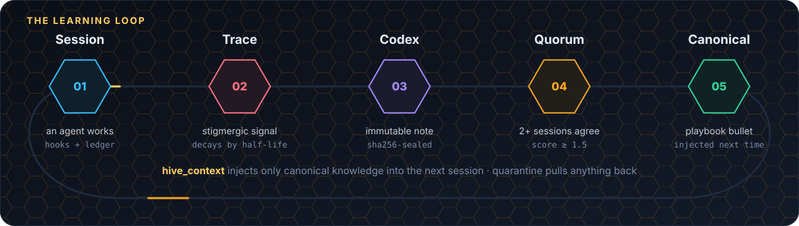
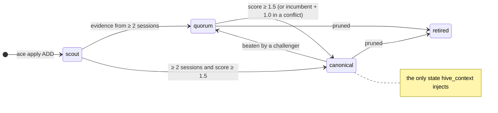
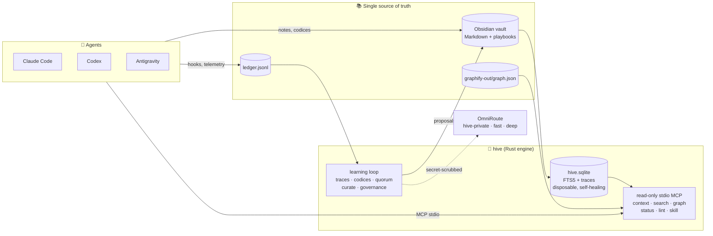

<div align="center">



<br>

[](src/)
[](hive.py)
[](#-mcp-tools)
[](docs/vault-conventions.md)
[](LICENSE)

**[Quick start](#-quick-start)** ·
**[How it works](#-how-it-works)** ·
**[Playground](#-try-it-in-your-browser)** ·
**[MCP tools](#-mcp-tools)** ·
**[CLI](#%EF%B8%8F-command-line)** ·
**[Docs](#-documentation)**

</div>



## 🐝 What is this?

Every coding agent you run starts each session with amnesia. **Hive Mind** gives them one shared memory.

Your agents write plain Markdown notes into an Obsidian vault. The hive indexes them, ranks them, and
packs exactly what matters into a token budget. It hands that pack to  **Claude Code**,
 **Codex** and  **Antigravity**
over a read-only MCP server. Then it learns: each session leaves signals that fade, lessons that must earn
a quorum, and sealed records that can never be silently edited.



> [!TIP]
> **Notes stay the single source of truth.** Every index is disposable: delete `hive.sqlite` and the hive
> rebuilds it. A corrupt index heals itself on the next open.

## ⚡ See it think

One agent hits a dead end. The next agent, a different model in a different session, sees the warning
before it repeats the mistake:



## 🧬 How it works



| Layer | What it does | Where it lives |
|---|---|---|
| 🔎 **Retrieval** | BM25 over SQLite FTS5 (titles ×5, ADRs and memory boosted, weak tail cut), Personalized PageRank over [graphify](https://docs.graphify.com) code graphs, packed to a token budget | `index.rs`, `graph.rs`, `packer.rs` |
| 🐜 **Stigmergy** | Agents leave `DEAD_END`, `RECENT_FIX` and `HOT_FILE` traces that decay by half-life. Only a *different* real session can reinforce one | `trace.rs`, `traces.py` |
| 📜 **Codices** | Session checkpoints become immutable notes sealed with `content_sha256`. Editing one is a lint `ERROR` | `codex.rs`, `codex.py` |
| 📬 **Handoffs** | Role-aware, token-bounded transfer of outcomes, completed steps, files, dead ends and open threads | `hive handoff`, `codex.rs` |
| ✂️ **Concise output** | Search, graph and lint return short results by default; request full detail when needed | `src/mcp/tools.rs` |
| 📦 **Artifact offload** | Large MCP results are secret-scrubbed and cached outside the vault and project repositories; old files are purged on writes | `artifact.rs`, `artifacts.py` |
| 🗳️ **Quorum** | New lessons start as *scouts*. Only bullets backed by 2+ sessions with score ≥ 1.5 become *canonical* and reach agents | `quorum.rs`, `quorum.py` |
| ⚔️ **Conflicts** | Contradicting lessons are detected; a challenger must beat the incumbent by +1.0. Losers are hidden, never deleted | `curate.rs`, `_meta/_conflicts.md` |
| 🛡️ **Governance** | `hive quarantine` pulls a session's or agent's output from every read path at once, reversibly. `hive audit` shows the full provenance chain | `governance.rs` |
| 🧠 **ACE playbooks** | Deterministic delta merges of lessons with helpful and harmful counters, time decay, and atomic locking | `ace.rs`, `skills/hive-ace` |

<details>
<summary><b>📉 Why traces fade instead of piling up</b> (click to expand)</summary>
<br>



A warning that was true yesterday may be wrong next week. Traces live in the disposable index, never in
the vault. They weaken as `w₀ · 2^(−age / half-life)`, drop out of every read path below `0.15`, and are
purged after 7 days. A trace that two independent sessions confirm drafts a playbook proposal into
`inbox/`, where it starts its own climb to canonical.

</details>

<details>
<summary><b>🗳️ The quorum state machine</b></summary>
<br>



Evidence weights: `test_pass` 1.0 · `confirm` 1.0 · `self_tag` 0.35. Each session counts **once**, at its
strongest evidence. Session and evidence fields in a CLI delta are stripped (trust boundary), so no agent
can vote for itself twice.

</details>

<details>
<summary><b>🏗️ Full architecture</b></summary>
<br>



</details>

## 🎮 Try it in your browser

The **[Hive Playground](https://4lph7.github.io/Hive_Mind/playground/)** runs the real decay and quorum rules
live: drag a trace through time, stack evidence from different sessions, and watch a lesson climb from
scout to canonical or lose a conflict.

> [!NOTE]
> The playground is one static file, [`docs/playground/index.html`](docs/playground/index.html). It works
> offline, so you can open it locally. The link above serves it through GitHub Pages
> (Settings → Pages → branch `main`, folder `/docs`).

## 🚀 Quick start

<details open>
<summary> <b>Native binary</b> (recommended, under 1 ms startup)</summary>

```bash
git clone https://github.com/4LPH7/Hive_Mind.git
cd Hive_Mind
cargo build --release          # target/release/hive(.exe), SQLite bundled
cargo test                     # unit + integration tests, no network
cargo run --release -- status  # index the vault, report graph freshness
```

</details>

<details>
<summary> <b>Pure Python</b> (stdlib only, zero install)</summary>

```bash
cargo test                      # unit and integration tests, no network or model
cargo run --release -- status   # index the vault and report graph freshness
python hive.py status           # launcher: runs the release binary (build it first)
```

Set `HIVE_BIN` to point the launchers at a binary elsewhere.

</details>

### Connect your agents

<details>
<summary> <b>Claude Code</b></summary>

```bash
claude mcp add hive -- /path/to/Hive_Mind/target/release/hive serve
```

Hooks for traces and ACE checkpoints: [`examples/claude-settings-hooks.json`](examples/claude-settings-hooks.json).

</details>

<details>
<summary> <b>Codex</b> (<code>~/.codex/config.toml</code>)</summary>

```toml
[mcp_servers.hive]
command = "/path/to/Hive_Mind/target/release/hive"
args = ["serve"]
```

See [`examples/codex-config.toml`](examples/codex-config.toml) and [`examples/codex-hooks.json`](examples/codex-hooks.json).

</details>

<details>
<summary> <b>Antigravity</b> (<code>~/.gemini/antigravity/mcp_config.json</code>)</summary>

```json
{
  "mcpServers": {
    "hive": { "command": "/path/to/Hive_Mind/target/release/hive", "args": ["serve"] }
  }
}
```

See [`examples/antigravity-mcp_config.json`](examples/antigravity-mcp_config.json).

</details>

<details>
<summary>⚙️ <b>Configuration</b> (CLI flag → env → config.toml → defaults)</summary>

1. **CLI flags:** `--vault`, `--projects`, `--db`, `--config`
2. **Environment:** `HIVE_VAULT`, `HIVE_PROJECTS`, `HIVE_DB`, `HIVE_ARTIFACTS`
3. **`~/.config/hive/config.toml`**

   ```toml
   vault = "/path/to/Obsidian/Vault"
   projects = "/path/to/Projects"

   [llm]
   enabled = true
   base_url = "http://127.0.0.1:20128/v1"   # OmniRoute
   timeout_ms = 120000

   [llm.combos]
   private = "hive-private"
   fast = "hive-fast"
   deep = "hive-deep"

   [projects.my-secret-repo]
   llm_privacy = "private"   # hard-lock: never leaves localhost
   ```

4. **Defaults:** `~/Documents/Vault`, with the index in `%LOCALAPPDATA%\hive\` or `~/.cache/hive/`

</details>

## 🧰 MCP tools

Vault content is read-only through MCP. `hive_skill` may install a requested skill to the local skills directory, and large results may use the disposable artifact cache.

| Tool | Returns |
|---|---|
| `hive_context(project, task?, budget=1500, handoff?)` | **Call first.** Active-work row, `_memory.md` (framed as untrusted), ADRs, canonical playbook lessons, live traces, codex dead ends, matching notes and ranked code symbols. `handoff` selects one bounded, untrusted handoff envelope |
| `hive_search(query, project?, scope?, limit=8, detail?)` | BM25 over every note, project-isolated by default; quarantined items never appear |
| `hive_graph(repo, query, limit=15, detail?)` | Code-graph neighbourhood with `file:line`, edges, related notes and staleness |
| `hive_skill(task)` | Best-matching skill instructions, or audited discovery from a registry |
| `hive_status()` | Notes per project, graph size and freshness |
| `hive_lint(detail?)` | Vault health: frontmatter, links, caps, stale memory, tampered codices |

`hive_search`, `hive_graph` and `hive_lint` accept `detail="detailed"` for full output. Results above about 2,000 estimated tokens are scrubbed and offloaded to a cache outside the vault and project repositories, except `hive_context` and errors. Set `HIVE_ARTIFACTS` to choose its directory. Cache files older than 7 days are purged when a new artifact is written.

## ⌨️ Command line

<details>
<summary><b>Every subcommand</b></summary>

| Command | Purpose |
|---|---|
| `hive serve` | MCP stdio server (what agents launch) |
| `hive context \| search \| graph \| status \| lint` | The MCP tools, for humans and hooks |
| `hive trace add <project> <KIND> <target> <summary>` · `trace list` | Leave or list stigmergic traces |
| `hive codex write <project> <record.json>` | Seal a session checkpoint into an immutable codex |
| `hive handoff write <project> <record.json>` | Write a bounded handoff; read it with `hive context <project> --handoff <id>` |
| `hive ace apply <scope> <delta.json>` | Merge playbook lessons deterministically (scouts by default) |
| `hive curate [--conflicts] [--dry-run]` | LLM-assisted curation and conflict judging, proposals to `inbox/` only |
| `hive quarantine --session <id> \| --agent <a> [--since]` · `--release <rule>` | Reversibly pull a bad actor's output from every read path |
| `hive audit <bullet-id \| trace:<n> \| codex-stem>` | Provenance chain: who wrote it, which sessions backed it, integrity |
| `hive ledger [score \| --coverage]` | Session telemetry and objective outcome scoring |
| `hive mine [--dry-run]` | Cluster zero-hit queries into gap proposals |
| `hive skill [match \| find \| install]` | Skill routing with a Trojan Source and injection audit gate |
| `hive eval` · `hive bench` | Recall@5 / MRR on the golden set, and latency benchmarks |
| `hive pre-commit` | Lint and tests as one cross-platform gate |

</details>

## 🔒 Safety model

| Threat | Defence |
|---|---|
| A poisoned note steers an agent | Vault text is framed as an untrusted, quoted note with its path, agent, source and age |
| One agent forges consensus | Quorum counts distinct, non-anonymous sessions; evidence fields in CLI deltas are stripped |
| A bad session spreads | `hive quarantine` hides its traces, scouts, codices and proposals everywhere, reversibly |
| Someone rewrites history | Codices carry `content_sha256`; any edit is a lint `ERROR` and shows in `hive audit` |
| Secrets leak to a model | Pre-egress scrubbing; private projects are hard-locked to local inference |
| A malicious skill | Unicode bidi, zero-width and injection audit gate, plus a SHA-256 tree lockfile |
| Network exposure | stdio only, zero open ports, read-only MCP |

## 📊 Performance

| Operation | Result |
|---|---|
| Cold binary start | < 1 ms |
| Hash-verified vault refresh | ~10 ms (unchanged notes skipped) |
| BM25 / FTS5 search | ~4 ms |
| Graph PPR, 1,698 nodes | 7.8 ms |
| Graph PPR, 3,427 nodes | 32.6 ms |
| Golden search eval | **Recall@5 30/30** |
| Live-traces slice for `hive_context` | < 10 ms |

## 🗺️ Roadmap

- [x] Native Rust core, Python parity mirror, read-only MCP
- [x] ACE playbooks, outcome scoring, gap mining, OmniRoute curation
- [x] **v2.6:** stigmergic traces and immutable codices
- [x] **v2.7:** quorum promotion, conflict cross-inhibition, quarantine, audit, self-healing index
- [x] **v2.7.1:** role-aware handoffs, concise MCP responses and large-result artifact offload
- [ ] Ratchet: turn recurring dead ends into lint rules
- [ ] Learned retrieval weights from scored sessions

## 📚 Documentation

| | |
|---|---|
| [Architecture](docs/architecture.md) | Components, data flow, ranking maths |
| [Setup](docs/setup.md) | From an empty folder to three agents sharing one memory |
| [Vault conventions](docs/vault-conventions.md) | The folder and frontmatter contract agents follow |
| [ACE playbooks](docs/ace.md) | How the hive learns lessons from sessions |
| [Lint](docs/lint.md) | Every check, its severity and its fix |
| [Design decisions](docs/decisions.md) | What was built, what was rejected, and why |
| [Changelog](CHANGELOG.md) | Release history |

<div align="center">
<br>

<sub>Shared memory for AI-assisted development. BSL 1.1, converts to Apache-2.0 on 2030-11-27.<br>
Logos from <a href="https://simpleicons.org">Simple Icons</a> (CC0) and <a href="https://github.com/lobehub/lobe-icons">Lobe Icons</a> (MIT, <a href="assets/readme/logos/THIRD_PARTY_NOTICES.md">notice</a>); trademarks belong to their owners.</sub>

</div>
